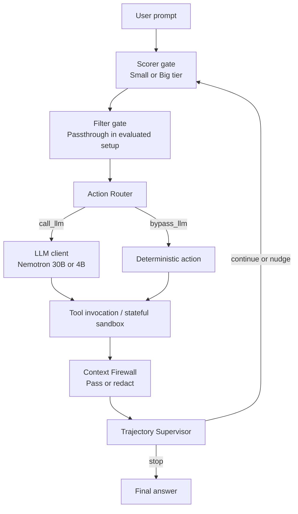

# LAYA — Micro-Gated Orchestration for LLM Agents

**LAYA** (Latency-Aware, Adversarially-robust, Yield-optimized Agent) is a research framework for controlling tool-using Large Language Model (LLM) agents with lightweight local gates. It explores how model-tier selection, deterministic action routing, untrusted-context filtering, and trajectory supervision can be separated from the LLM's main reasoning loop.

> **Research status:** This repository accompanies a research preprint. The reported evaluation uses the 25-task development split; the held-out test split has not yet been evaluated. LAYA is a research prototype, not a production security guarantee.

## Overview

Tool-using agents commonly rely on repeated LLM calls while processing tool outputs that may contain untrusted instructions. LAYA adds a micro-gated control layer around a ReAct-style agent loop.

The implementation evaluated in the paper includes four active gate primitives and one Filter gate that is present as a structural interface but remains in passthrough mode:

| Component | Purpose | Evaluated status |
|---|---|---|
| **Scorer** | Chooses between the small and big model tiers based on task/context complexity. | Active |
| **Filter** | Intended to prune redundant or noisy conversational context. | Passthrough; not evaluated as an active gate |
| **Action Router** | Determines whether a deterministic queued action can bypass another LLM call or whether generation should continue. | Active |
| **Context Firewall** | Inspects tool-output chunks and can pass or redact suspected injection content. | Active |
| **Trajectory Supervisor** | Reviews trajectory state and chooses whether to continue, nudge, or stop. | Active |

### High-level control flow



The diagram is a conceptual summary of the control flow described in the accompanying paper. See the implementation and configuration in the repository for the exact behavior.

## Experimental evaluation

The paper reports **525 live execution runs** on a 25-task development split:

- 25 unique base tasks
- 3 conditions per task: benign, `injection_1`, and `injection_2`
- 7 experimental configurations
- 75 runs per configuration

The held-out test split was not evaluated in the reported campaign.

### Experimental configurations

| ID | Configuration | Summary |
|---|---|---|
| **Arm A** | Big Baseline | Always uses the big model; no gate primitives. |
| **Arm B-Regex** | Regex Firewall | Big model with rule-based context filtering. |
| **Arm B-Neural** | Neural Firewall + Supervisor | Big model with neural firewall and trajectory supervisor. |
| **Arm C-Small** | Always-Small | Uses the small model tier with the evaluated firewall and supervisor components. |
| **Arm C-Random** | Random Tier Routing | Random 50/50 big/small tier selection; negative control. |
| **Arm C-Dynamic** | Dynamic Scorer | Complexity-based big/small routing without the Action Router. |
| **Arm D** | Full LAYA | Full evaluated orchestration: Scorer, Action Router, Firewall, and Supervisor; Filter remains passthrough. |

### Reported results

The values below are copied from the reported development-split evaluation.

| Configuration | Benign utility | Attack utility | Observed ASR | Mean cost / task | Mean LLM calls | Gate latency p50 / p95 (ms) |
|---|---:|---:|---:|---:|---:|---:|
| Arm A | 24.0% | 2.0% | 0.0% | $0.0021 | 1.2 | 0.0 / 0.0 |
| Arm B-Regex | 36.0% | 4.0% | 0.0% | $0.0024 | 1.4 | 0.1 / 0.2 |
| Arm B-Neural | 32.0% | 6.0% | 0.0% | $0.0020 | 1.1 | 35.2 / 2644.6 |
| Arm C-Small | 96.0% | 84.0% | 0.0% | $0.0006 | 2.2 | 37.9 / 79.2 |
| Arm C-Random | 100.0% | 82.0% | 2.0% | $0.0005 | 2.1 | 36.6 / 77.7 |
| Arm C-Dynamic | 60.0% | 6.0% | 0.0% | $0.0016 | 1.3 | 35.4 / 75.7 |
| Arm D — Full LAYA | 80.0% | 4.0% | 0.0% | $0.0017 | 1.4 | 35.0 / 70.6 |

**How to interpret the security results:** Arm D had 0 observed attack successes in 50 injection runs. This is not proof of zero risk; the paper reports a one-sided 95% Clopper–Pearson upper confidence bound of 5.8% for 0/50 events. Arm C-Random recorded 1 attack success in 50 injection runs (2.0% observed ASR).

**Attack Utility** measures completion of the original benign user goal when an injection is present. It is distinct from Attack Success Rate (ASR), which measures successful execution of the injected adversarial goal.

## Models and evaluation environment

The reported campaign used NVIDIA NIM-hosted Nemotron endpoints:

- **Big tier:** `nvidia/nemotron-3.5-lightning-30b-a3b`
- **Small tier:** `nvidia/nemotron-3.5-bolt-e4b`

The paper reports local gate timing on a single NVIDIA Tesla T4 GPU (16 GB VRAM), using a Google Colab Linux runtime with Python 3.13. LLM inference was performed through the NVIDIA NIM API gateway. The evaluation used a stateful mock sandbox across Workspace, Travel, Slack, and Banking-style task domains.

The generation budget was capped at 512 tokens per LLM completion in the reported experiments.

## Repository structure

The repository currently includes the following top-level areas:

```text
layainAGENT/
├── docs/              # Project documentation
├── laya_agent/        # LAYA implementation
├── policies/          # Policy resources
├── tests/             # Tests
├── requirements.txt   # Python dependencies
└── splits.json        # Evaluation split definitions
```

Refer to the source files and configuration under `laya_agent/` for implementation details.

## Setup

### 1. Clone the repository

```bash
git clone https://github.com/naveendha1710/layainAGENT.git
cd layainAGENT
```

### 2. Create and activate a virtual environment

**Linux / macOS**

```bash
python -m venv .venv
source .venv/bin/activate
```

**Windows PowerShell**

```powershell
python -m venv .venv
.venv\Scripts\Activate.ps1
```

### 3. Install the listed Python dependencies

```bash
python -m pip install --upgrade pip
python -m pip install -r requirements.txt
```

### 4. Install the LAYA runtime dependency

The repository's `requirements.txt` notes that the `laya` ModernBERT-large runtime is distributed separately and is not available from the standard PyPI package index. Install it using the installation instructions provided by the upstream LAYA runtime distribution referenced in `requirements.txt` (`NandhaKishorM/laya`).

The requirements file also identifies additional dependencies used by the later milestones, including PyTorch, OpenAI-compatible client support, FAISS, Sentence Transformers, and AgentDojo.

### 5. Configure model tiers and credentials

The project uses explicit model-tier configuration. The code and paper identify these configuration inputs:

- `BIG_TIER_MODEL`
- `SMALL_TIER_MODEL`
- `laya_agent/configs/arms.yaml`

For the reported configuration, the model IDs were:

```text
BIG_TIER_MODEL=nvidia/nemotron-3.5-lightning-30b-a3b
SMALL_TIER_MODEL=nvidia/nemotron-3.5-bolt-e4b
```

Configure your NVIDIA NIM API credentials using the mechanism expected by the repository's LLM client. Do not commit API keys, tokens, `.env` files, or other secrets to Git.

### 6. Run the evaluation campaign

From the repository root, the following commands are provided for a quick preflight and for the full development-split campaign.

**Quick preflight — one base task across all seven configurations**

```bash
python -u -m laya_agent.eval.campaign --split dev --arms all --max-tasks 1 --verbose
```

The benchmark has three conditions per base task (benign, `injection_1`, and `injection_2`). Therefore, a one-task preflight across all seven configurations can execute up to 21 trajectories (1 base task × 3 conditions × 7 configurations), subject to the campaign runner's filtering and configuration.

**Full 525-run development-split campaign with checkpoint resumption**

```bash
python -u -m laya_agent.eval.campaign --split dev --arms all --resume --verbose
```

The reported campaign comprises 25 base tasks × 3 conditions × 7 configurations = 525 trajectories. The `--resume` option is included for checkpoint-based continuation after interruptions.

> **Important:** These commands invoke hosted model endpoints and may incur API usage or charges. Confirm that model IDs, API credentials, dependencies, local gate checkpoints, and evaluation configuration are set up before running. The full command is not a lightweight smoke test. The held-out test split was not evaluated in the reported paper.

## Tests

The repository includes a `tests/` directory and lists `pytest` as a dependency. From the repository root, run:

```bash
pytest
```

This runs the available test suite. It does not by itself reproduce the 525-run experimental campaign.

## Reproducibility notes and limitations

Please keep the following limitations in mind when interpreting or reproducing the reported results:

1. **Development split only:** Results are from the 25-task `dev` split. The held-out test split has not yet been evaluated.
2. **Limited injection sample:** Each configuration has 50 injection runs. A measured 0.0% ASR should not be interpreted as a guarantee of security.
3. **Filter gate inactive:** The Filter gate operated in passthrough mode and context pruning was not evaluated.
4. **Mock sandbox:** The stateful sandbox does not fully model real-world API behavior, network variability, or schema drift.
5. **Hardware scope:** Gate latency was measured on an NVIDIA Tesla T4; other hardware platforms were not evaluated in the reported campaign.
6. **Calibration and fallback:** The paper reports elevated Scorer and Supervisor fallback rates, as well as a large cold-start p95 latency in the Arm B-Neural configuration.

For the full methodology, result definitions, confidence intervals, discussion, and limitations, refer to the research paper associated with this repository.

## Research paper and citation

**LAYA: Micro-Gated Multi-Arm Orchestration for Dual-Tier LLM Agent Security and Computational Efficiency**  
*Author:* Naveen Kumar (Rathinam Global Deemed to Be University, Coimbatore, India)  
*Preprint:* [Zenodo DOI](https://zenodo.org/records/23857217)

BibTeX entry (update the DOI field after publication):

```bibtex
@article{kumar2026laya,
  title  = {LAYA: Micro-Gated Multi-Arm Orchestration for Dual-Tier LLM Agent Security and Computational Efficiency},
  author = {Naveen,Kumar},
  year   = {2026},
  note   = {Preprint on Zenodo},
  doi    = {10.5281/zenodo.23857217}
}
```

## Contributing

This repository is primarily a research project. For bug reports, questions, or suggested improvements, please use GitHub Issues or submit a pull request with a clear description of the change.

## License

**Repository software license: not yet specified.** No MIT or Apache-2.0 license is being asserted by this README, and source-code reuse or redistribution permissions should not be inferred until the repository owner selects a license and adds its complete license text in a root-level `LICENSE` file.

Two common choices for software projects are:

- **MIT License:** A short, permissive license with broad reuse rights, subject to preserving the copyright and license notice.
- **Apache License 2.0:** A permissive license that also includes express patent-grant and patent-termination provisions.

Choose and add one only if it reflects the author's intent. Once the `LICENSE` file has been committed, update this section to name the selected license and link to that file.

The paper's Creative Commons Attribution 4.0 International (CC BY 4.0) license, if applied to the Zenodo preprint, does **not** automatically establish the software source-code license.
